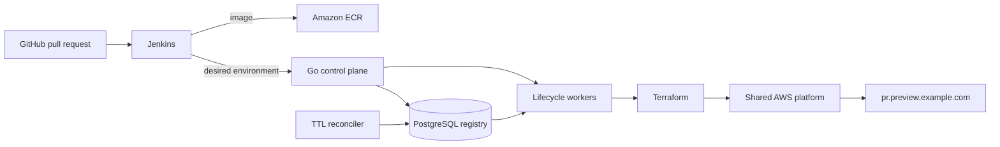

# Ephemera

Ephemera is a self-service control plane that turns a pull request into an isolated, observable, policy-controlled, automatically expiring preview environment.

It deliberately keeps Jenkins thin. CI builds and publishes an immutable image, then asks the control plane for an environment. The control plane owns idempotency, lifecycle state, Terraform execution, health checks, retry/backoff, metadata, schema isolation, TTL cleanup, and orphan recovery.



## What is implemented

- Go REST API and standalone worker with atomic PostgreSQL state or a local JSON store.
- Idempotency on `repository + PR + commit SHA`; duplicate webhooks return the original environment.
- Explicit lifecycle: `REQUESTED → PLANNING → PROVISIONING → HEALTH_CHECK → READY → DESTROYING → DESTROYED`.
- Failure states, bounded retry backoff, operation timeouts, stale-operation recovery, and a periodic TTL reaper.
- Policy limits for TTL, CPU, memory, owner capacity, repository capacity, and database mode.
- Demo provisioner with real local preview/health endpoints for safe end-to-end testing.
- Terraform provisioner with one remote workspace per environment and direct argument execution—no shell interpolation.
- Shared PostgreSQL schema creation and `DROP SCHEMA ... CASCADE` cleanup when `PREVIEW_DATABASE_URL` is configured.
- Shared AWS baseline for VPC, ECS Fargate, ALB, wildcard Route53, ECR, RDS, IAM, and CloudWatch.
- Per-environment Terraform module for ECS service, task definition, target group, host rule, logs, and database configuration.
- React operations dashboard with polling, search/status filters, lifecycle activity, TTL extension, retry, and cleanup actions.
- Jenkins multibranch pipeline for test, image publication, provisioning, readiness, smoke testing, and PR-close cleanup.
- Prometheus text metrics at `/metrics` and structured JSON logs.

## Quick start

### Docker Compose

Start Docker Desktop, then run:

```bash
docker compose up --build
```

Open [http://localhost:3000](http://localhost:3000). Compose runs PostgreSQL, the API/embedded worker, and the production dashboard. It uses the safe `demo` provider, so no AWS credentials are needed. A created environment reaches `READY` in a few seconds and its preview link opens a local lifecycle-simulator page.

Stop the stack with:

```bash
docker compose down
```

Add `-v` only when you intentionally want to remove the local PostgreSQL and Terraform data volumes.

### Without Docker

The API falls back to `data/environments.json` when `DATABASE_URL` is empty:

```bash
go run ./controller/cmd/api
```

In another terminal:

```bash
cd dashboard
npm install
npm run dev
```

Open [http://localhost:5173](http://localhost:5173). Vite proxies API requests to port 8080.

## API example

```bash
curl -X POST http://localhost:8080/api/v1/environments \
  -H 'Content-Type: application/json' \
  -H 'Idempotency-Key: acme/billing-api:127:a81f2aa9b32c' \
  -d '{
    "repository": "acme/billing-api",
    "branch": "feature/new-checkout",
    "commit_sha": "a81f2aa9b32c",
    "pull_request": 127,
    "owner": "bilal",
    "image": "demo-service:latest",
    "ttl": "6h",
    "resources": {"cpu": 512, "memory": 1024, "database_mode": "shared-schema"}
  }'
```

Core endpoints:

| Method | Path | Purpose |
|---|---|---|
| `POST` | `/api/v1/environments` | Idempotently request a preview |
| `GET` | `/api/v1/environments` | List/filter environments |
| `GET` | `/api/v1/environments/{id}` | Inspect state, events, and resources |
| `DELETE` | `/api/v1/environments/{id}` | Set desired state to destroyed |
| `POST` | `/api/v1/environments/{id}/extend` | Extend TTL within the policy ceiling |
| `POST` | `/api/v1/environments/{id}/retry` | Retry failed provisioning or cleanup |
| `POST` | `/api/v1/reconcile` | Wake the reconciler |
| `GET` | `/healthz`, `/readyz`, `/metrics` | Operations endpoints |

The full contract is in [docs/openapi.yaml](docs/openapi.yaml).

## Production AWS path

1. Create the versioned and encrypted state bucket with `terraform/bootstrap`.
2. Copy `terraform/live/backend.hcl.example` to `terraform/live/backend.hcl` and set the bucket/region.
3. Apply `terraform/platform` with an existing Route53 zone and wildcard ACM certificate.
4. Export the platform outputs as the `TF_VAR_*` values shown in [.env.example](.env.example).
5. Set `PROVIDER=terraform`, `TERRAFORM_BACKEND_CONFIG=terraform/live/backend.hcl`, and `PREVIEW_DATABASE_URL`.
6. Give the controller a narrowly scoped AWS role and use OIDC/workload identity instead of long-lived keys.
7. Configure the Jenkins credentials and parameters documented in [jenkins/Jenkinsfile](jenkins/Jenkinsfile).

The included platform Terraform is a cost-conscious reference baseline: Fargate tasks use public IPs in public subnets to avoid a NAT gateway. For production, move workloads to private subnets and choose NAT or VPC endpoints according to traffic, security, and cost requirements.

## Configuration

| Variable | Default | Meaning |
|---|---:|---|
| `DATABASE_URL` | empty | PostgreSQL control-plane registry; JSON file when empty |
| `PREVIEW_DATABASE_URL` | empty | Shared application PostgreSQL used for isolated schemas |
| `PROVIDER` | `demo` | `demo` or `terraform` |
| `PREVIEW_DOMAIN` | `preview.localhost` | Production wildcard preview domain |
| `DEFAULT_TTL` / `MAX_TTL` | `6h` / `24h` | Lifecycle policy |
| `MAX_ENVIRONMENTS_PER_USER` | `3` | Active environment quota per owner |
| `MAX_ENVIRONMENTS_PER_REPO` | `10` | Active environment quota per repository |
| `WORKER_CONCURRENCY` | `4` | Parallel lifecycle operations |
| `OPERATION_TIMEOUT` | `20m` | Provision/destroy lease and deadline |
| `EPHEMERAL_API_KEY` | empty | Bearer token for API/metrics; required with `PROVIDER=terraform` |
| `TERRAFORM_BACKEND_CONFIG` | empty | Absolute or relative S3 backend config path |

See [.env.example](.env.example) for every setting.

## Verification

```bash
go test ./...
go test -race ./...
terraform fmt -check -recursive terraform
cd dashboard && npm run check && npm run build
```

More detail: [architecture](docs/architecture.md), [lifecycle](docs/lifecycle.md), [failure modes](docs/failure-modes.md), and [security](docs/security.md).
