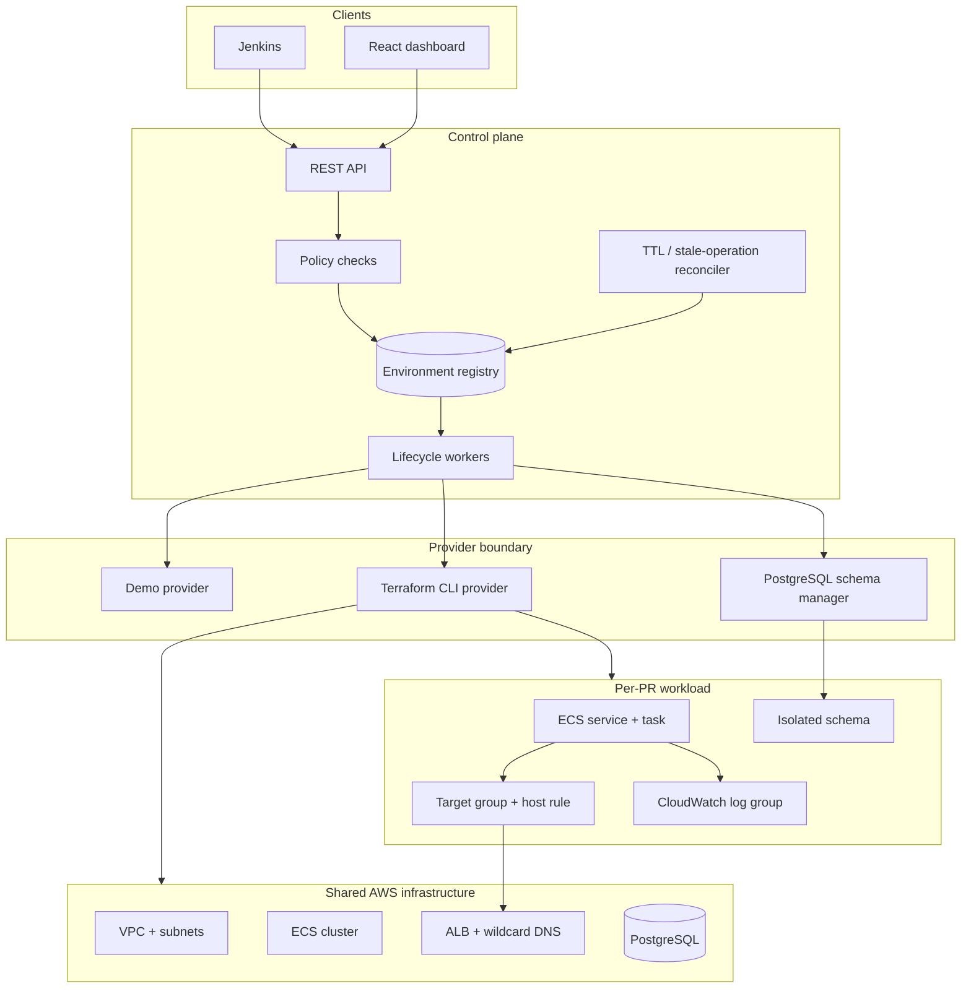

# Architecture

## Control plane and data plane

Terraform is a provisioning engine, not the product boundary. The Go control plane translates user/CI intent into a durable desired state, while workers reconcile that state against the provider.

## Isolation boundary

V1 shares the expensive, slow resources: VPC, ECS cluster, ALB, Route53 wildcard, RDS instance, and IAM roles. Each preview gets an ECS service/task definition, target group, listener rule, log group, Terraform workspace, and PostgreSQL schema.

This keeps provisioning fast while preserving the isolation that matters for a portfolio/demo application. A higher-risk workload can introduce stronger providers later—for example a database-per-preview or account-per-preview strategy—without changing the API lifecycle.

## Durable state and concurrency

PostgreSQL stores the full environment document plus indexed lifecycle columns. Updates run under `SELECT ... FOR UPDATE`, making status claims atomic across standalone workers. The local JSON adapter provides the same interface for one-process development.

The API records intent and returns. A worker claims `REQUESTED` or cleanup candidates, then performs the long-running provider action. Multiple workers may inspect the same candidate, but only one can transition it into the in-flight state.

## Terraform state

Each environment uses its own Terraform workspace and isolated `TF_DATA_DIR`. S3 state uses native lockfiles and versioning. A destroy in one workspace cannot address another environment's state. The controller executes Terraform with an argument array rather than a shell, and environment identifiers pass a strict DNS-label validation before reaching filesystem or CLI operations.

## Provider seam

`internal/provider.Provider` is intentionally small: `Provision`, `Destroy`, and lifecycle reporting. The local simulator and Terraform implementation use the same worker and state machine. A later ECS SDK, Kubernetes, Nomad, or account-factory provider can implement this interface without moving orchestration logic into Jenkins.
