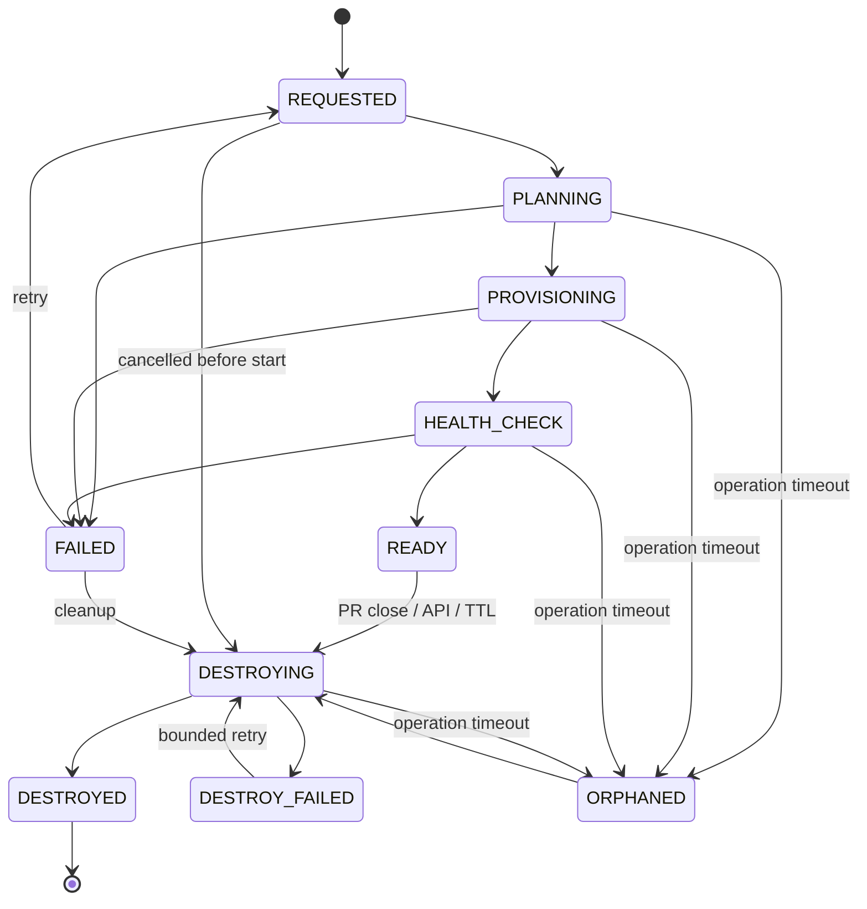

# Lifecycle and reconciliation

## Desired state

- `READY`: the pull request exists and its TTL is valid.
- `DESTROYED`: the PR closed, a user requested cleanup, or TTL expired.

The status describes current reality; desired state describes the target. Cleanup requests therefore remain recoverable even if the webhook sender or API client disappears immediately afterward.

## Idempotency

The default key is `lower(repository):pull_request:commit_sha`. A unique database constraint guarantees one environment for a webhook identity. A replay returns HTTP 200 with `Idempotency-Replayed: true`; the first request returns HTTP 201.

## TTL reaper

Every environment has `expires_at`. Each reconciliation pass marks expired active environments with desired state `DESTROYED`. A subsequent worker claim performs provider cleanup. This is independent of PR-close delivery.

## Crash recovery

Planning, provisioning, health-check, and destroy operations have an `updated_at` lease. If that lease exceeds `OPERATION_TIMEOUT`, reconciliation marks the environment `ORPHANED` and schedules cleanup. Destroy failures use exponential backoff capped at 64 seconds. Errors are truncated to 4,000 characters before persistence, and the latest 100 lifecycle events are retained.

## Database schema lifecycle

When `database_mode=shared-schema` and `PREVIEW_DATABASE_URL` is configured, the provider wrapper creates the validated schema before workload provisioning. If provisioning fails, it makes a bounded best-effort cleanup. Normal destruction removes the workload first and then drops the schema with `CASCADE`; a schema cleanup error moves the whole operation into the retryable cleanup path.
